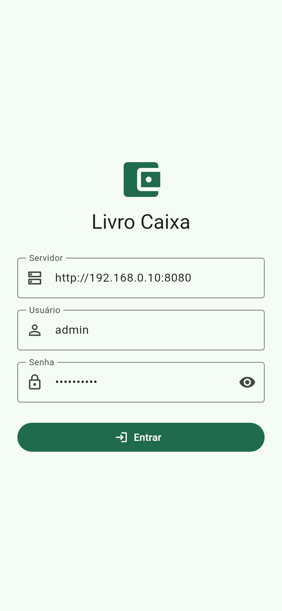
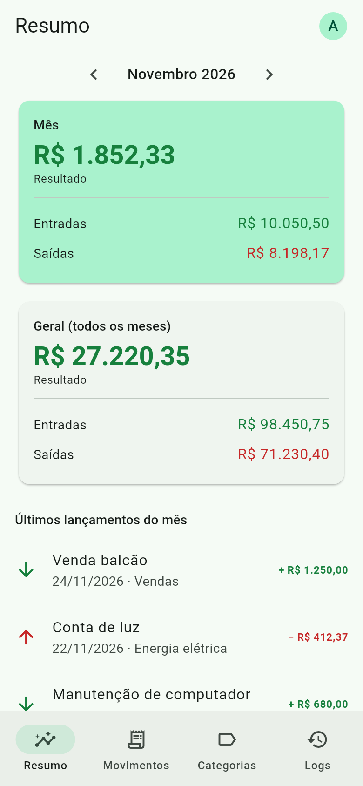
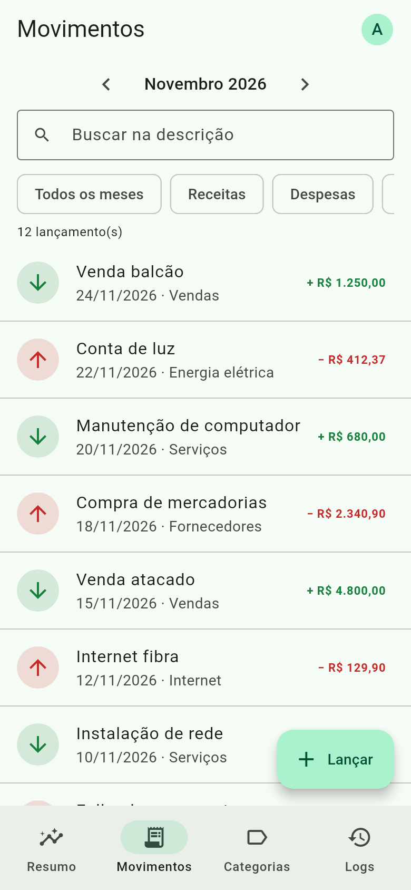
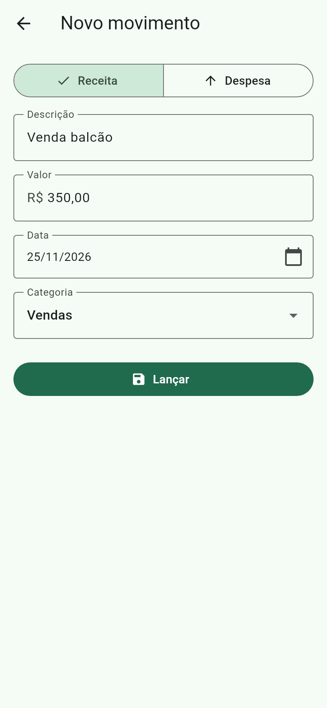
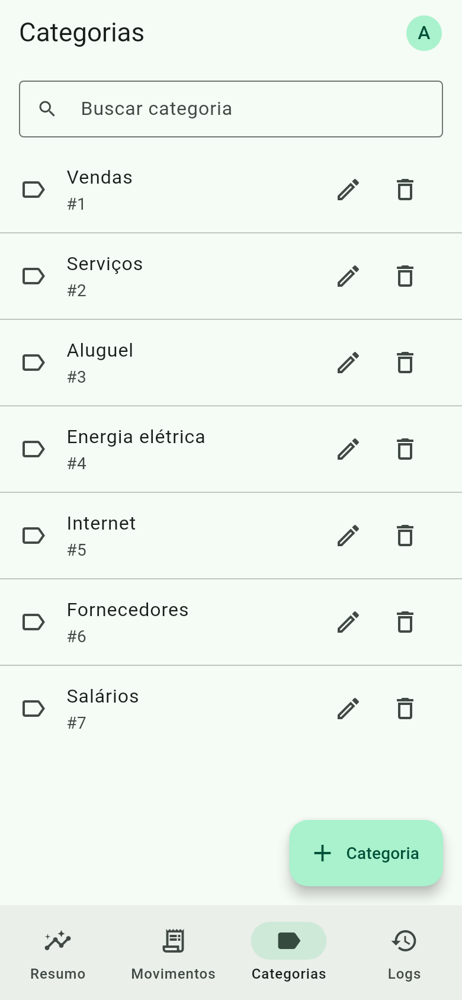
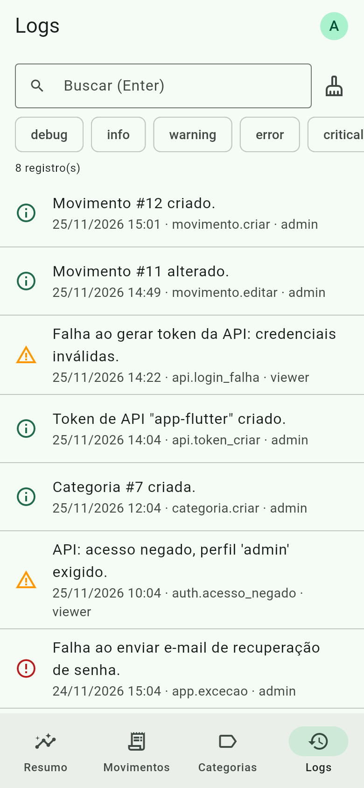
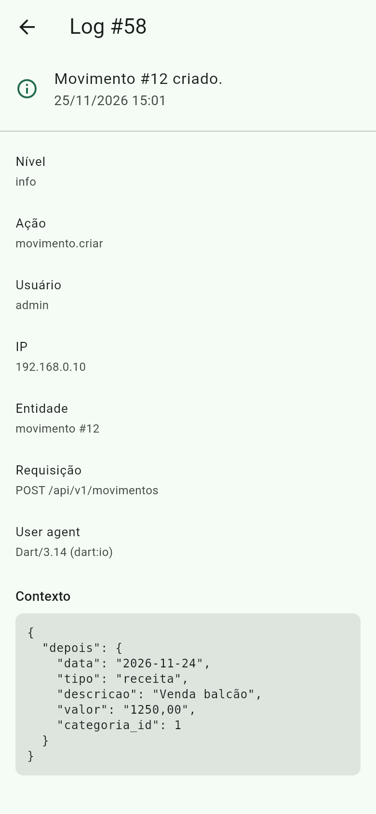
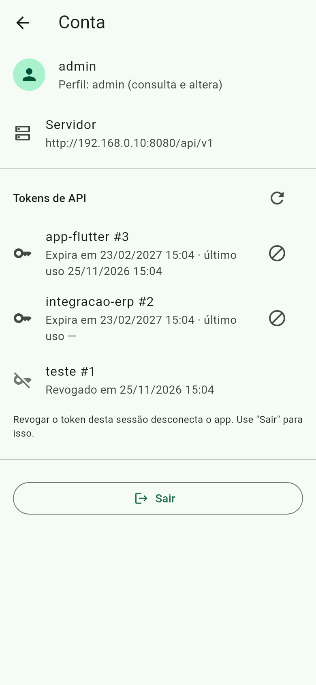
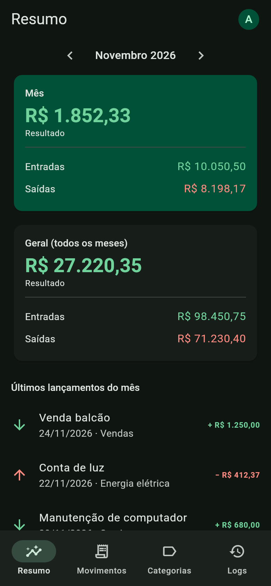

<p align="center">
  
</p>

<h1 align="center">Livro Caixa App</h1>

<p align="center">
  App Flutter (Android, Linux e Web) para a <a href="https://github.com/alexandrellemes/livro-caixa/blob/master/docs/API.md">API REST v1</a> do
  <a href="https://github.com/alexandrellemes/livro-caixa">Livro Caixa</a>: controle mensal de receitas e despesas.
</p>

## Telas

<table>
  <tr>
    <td align="center"><br><b>Login</b></td>
    <td align="center"><br><b>Resumo do mês</b></td>
    <td align="center"><br><b>Movimentos</b></td>
  </tr>
  <tr>
    <td align="center"><br><b>Novo movimento</b></td>
    <td align="center"><br><b>Categorias</b></td>
    <td align="center"><br><b>Logs (admin)</b></td>
  </tr>
  <tr>
    <td align="center"><br><b>Detalhe do log</b></td>
    <td align="center"><br><b>Conta e tokens</b></td>
    <td align="center"><br><b>Tema escuro</b></td>
  </tr>
</table>

> Os prints usam dados fictícios. Para gerá-los de novo (por exemplo, depois de mudar uma tela):
>
> ```bash
> flutter test --update-goldens tool/screenshots/screenshots_test.dart
> ```
>
> O script abre o app real com uma API simulada e grava as imagens em `docs/screenshots/`.

## Funcionalidades

| Tela | Endpoints |
|---|---|
| Login (servidor, usuário, senha) | `POST /auth/token`, `GET /auth/me` |
| Resumo do mês e geral + últimos lançamentos | `GET /resumo`, `GET /movimentos` |
| Movimentos: filtros por mês, tipo, categoria e busca, paginação infinita, lançar/editar/remover | `GET/POST/PUT/DELETE /movimentos` |
| Categorias: busca, criar/editar/remover (409 explicado quando há movimentos) | `GET/POST/PUT/DELETE /categorias` |
| Logs (só admin): filtro por nível, busca, detalhe com contexto, limpeza | `GET /logs`, `GET /logs/{id}`, `DELETE /logs` |
| Conta: perfil, tokens, revogar, sair | `GET /auth/tokens`, `DELETE /auth/tokens/{id}`, `DELETE /auth/token` |

O perfil `viewer` só consulta; os botões de alteração aparecem apenas para `admin`.
Token e URL ficam salvos no dispositivo (`shared_preferences`); um 401 leva de volta ao login.

## Executar

Plataformas configuradas: Android, Linux e Web.

```bash
flutter pub get
flutter analyze
flutter test
flutter run -d linux      # ou -d chrome, ou um dispositivo Android
```

Ícones: a imagem-fonte está em `assets/icon/`; para regenerar os ícones de Android e Web rode `dart run flutter_launcher_icons`.
O ícone da janela no Linux é `linux/runner/app_icon.png`.

### Projeto em disco NTFS (sem permissão de execução)

Se o projeto estiver num disco montado sem `exec` (ex.: NTFS via ntfs-3g), binários e scripts gerados ali não rodam:

- **Linux:** aponte `build/` para um disco Linux: `ln -s ~/.cache/livro_caixa_app_build build` (o `.gitignore` já ignora o link).
- **Android:** o `android/gradlew` também precisa executar. Monte o disco com a opção `exec` ou compile a partir de uma cópia num disco Linux.

### Endereço do servidor

| Onde o app roda | Servidor |
|---|---|
| Linux desktop / web no mesmo PC | `http://localhost:8080` |
| Emulador Android | `http://10.0.2.2:8080` (padrão no Android) |
| Celular na mesma rede | `http://IP-DO-PC:8080` |

### Android: liberar HTTP sem TLS

A API local usa `http://`, por isso o `android/app/src/main/AndroidManifest.xml` já declara a permissão `INTERNET` e `android:usesCleartextTraffic="true"`. Para produção, use HTTPS e remova essa opção.

### Web: CORS

Para rodar no navegador (`flutter run -d chrome`), defina no `.env` da API a origem do app, ex.: `API_CORS_ORIGIN=*` (somente em desenvolvimento).

## Estrutura

```
lib/
  api/api_client.dart   cliente HTTP da API (token Bearer, erros -> ApiException)
  models/               Categoria, Movimento, Resumo, LogEntry, TokenInfo, Paginado
  session.dart          login/logout e persistência do token
  screens/              telas
  widgets/              componentes comuns (erro, vazio, seletor de mês, recarga entre abas)
  util/format.dart      moeda, datas e conversão de valores pt-BR
test/                   testes do cliente da API e de widgets
tool/screenshots/       gerador dos prints do README (API simulada)
docs/screenshots/       prints das telas
assets/icon/            imagem-fonte do ícone
```
